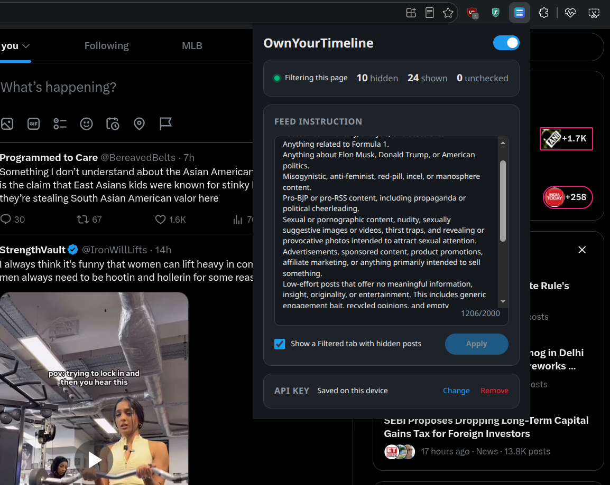

# OwnYourTimeline

A Chrome/Edge extension (Manifest V3) that filters your X Home feed, both For you and Following, with a plain-language instruction such as "Nothing political". Posts are classified by [TypeSafe](https://typesafe.ai) Jev using your own API key.



## Install from source

Requires Node.js 22+ and Chrome or Edge 120+.

```sh
npm ci
npm run build
```

Open `chrome://extensions` (or `edge://extensions`), enable Developer mode, click **Load unpacked**, and select `dist/`. After an update, click Reload on OwnYourTimeline and refresh any open X tabs.

In the popup, save your TypeSafe key, write an instruction, click **Apply**, and enable filtering.

## How it works

1. `main.ts` runs in X's page at `document_start` and wraps `XMLHttpRequest` and `fetch`. Only `HomeTimeline` and `HomeLatestTimeline` responses on `/home` are touched.
2. The response is held while its posts are extracted: text, long-form notes, up to two levels of quotes, images, and video thumbnails (`timeline-data.ts`).
3. Posts travel through the content script to the service worker, which sends **one bulk request per response** to TypeSafe. It splits only to stay within context and upload budgets and at most eight images per request. Images are downloaded from `pbs.twimg.com` and resized first.
4. Posts scoring at least 0.90 are removed from the JSON. X then renders what is left, so filtered posts never appear, not even for a frame. Cursors and non-post modules are left alone.
5. Filtering fails open. Errors, timeouts, unsupported shapes, and incomplete posts are delivered unchanged. A response is held for at most 60 seconds, and each bulk request gets 10 seconds.
6. As a fallback, native cards that X had already cached for a filtered post are hidden by their permalink (`confirmed-filter.ts`).
7. Decisions are cached per tab and page load. Changing the instruction or pausing reloads open Home tabs, so X rebuilds its feed from fresh responses.

The optional **Filtered** tab sits beside For you and Following. It shows up to 200 posts hidden on the current page as read-only cards. Nothing is persisted.

## Privacy and cost

- Post text, quotes, images, and your instruction go directly to `api.typesafe.ai`. There is no other server and no analytics.
- By default the key lasts for the browser session. "Remember key" stores it in extension storage that content scripts cannot read. It is not encrypted.
- A Home response normally costs one billable TypeSafe call. Saving a key makes one small test call.

## Debugging

Release builds contain no logging. To investigate a problem, use the dev build:

```sh
npm run build:dev
```

Load `dist-dev/` as **OwnYourTimeline (dev)** and disable the release extension, since both would intercept X. The dev build always records the full pipeline in extension storage, keeping the latest 500 events. That covers raw Home responses, extracted posts, TypeSafe requests and responses with image bytes omitted, per-post results, and what X finally received. Reproduce the problem, then click **Export log** in the popup. The export contains post text and your instruction but never your API key.

## Development

```sh
npm run check                    # TypeScript
npx playwright install chromium  # once
npm test                         # unit + browser tests
```

- Unit tests cover X response parsing, card sanitizing, provider answer validation, image layout, and request grouping.
- Browser tests run the real built extension in Chromium. Only x.com and TypeSafe are stubbed at the network layer. They cover filtering before render, fail-open behaviour, pause and resume, the Filtered tab, the dev log export, and the XHR and fetch interceptor.

## Publishing

`npm run package` builds the release and zips `dist/` into `ownyourtimeline.zip` for the Chrome Web Store. `npm run store:assets` regenerates the icons, screenshots and promo tile. Dashboard answers are in [store/LISTING.md](store/LISTING.md), and the privacy policy is [PRIVACY.md](PRIVACY.md).

## Limitations

This depends on X's private, undocumented response formats and can break whenever X changes them. Filtering is best-effort. At most 80 posts per response are checked, and anything the parser doesn't recognise is shown unfiltered.

## License

[MIT](LICENSE)
